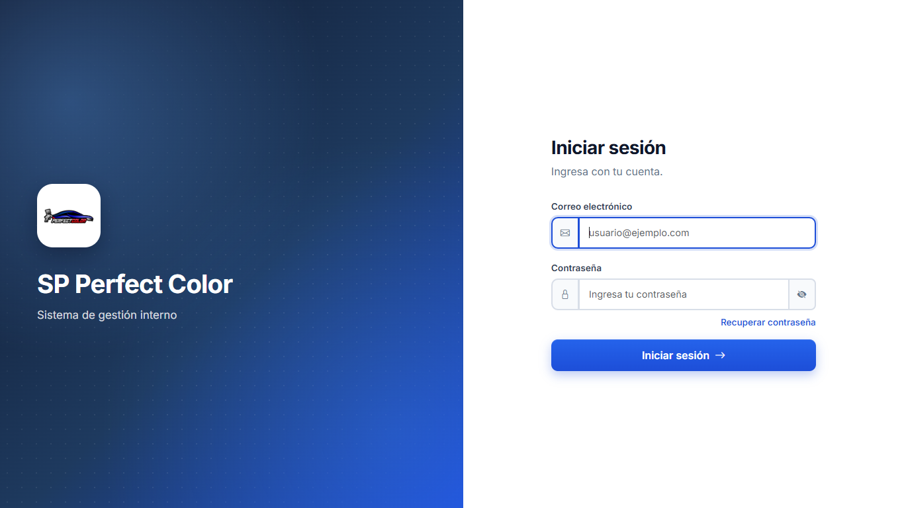
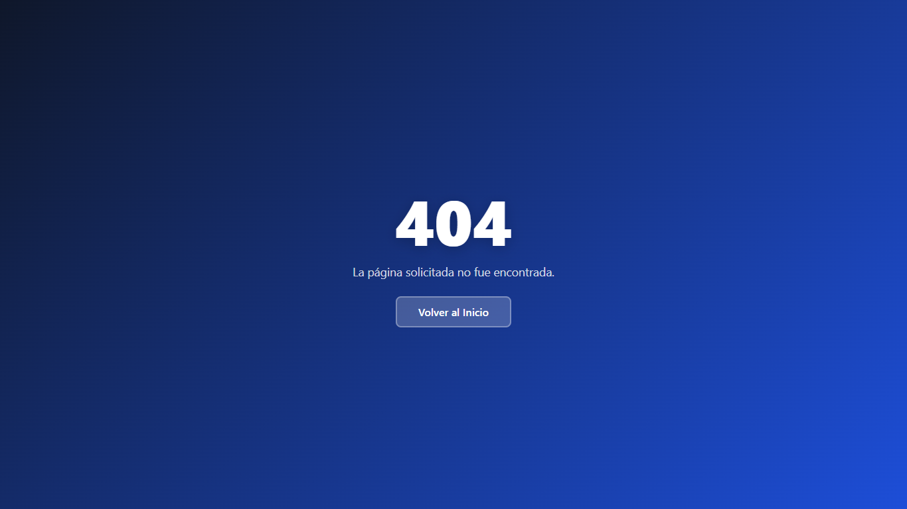
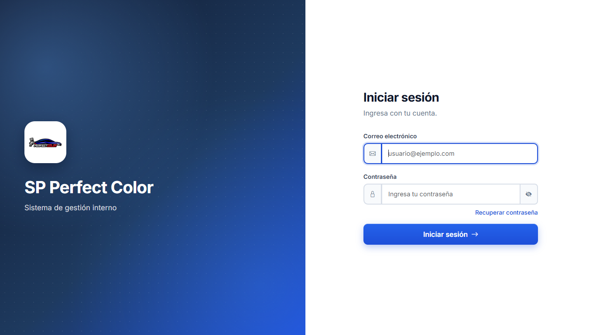
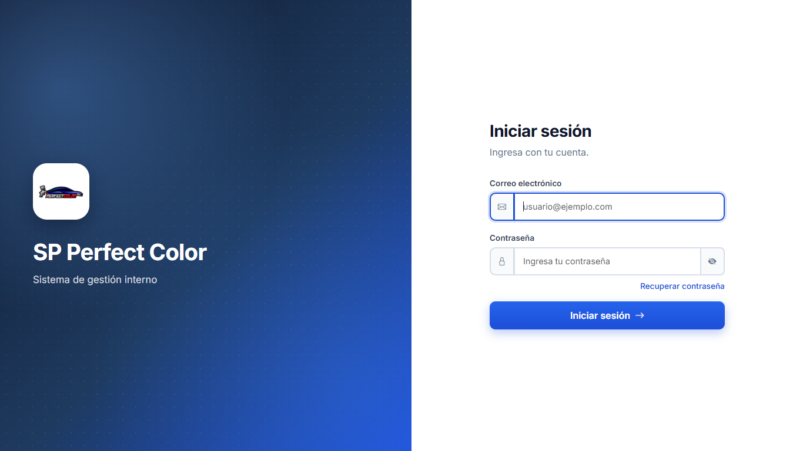
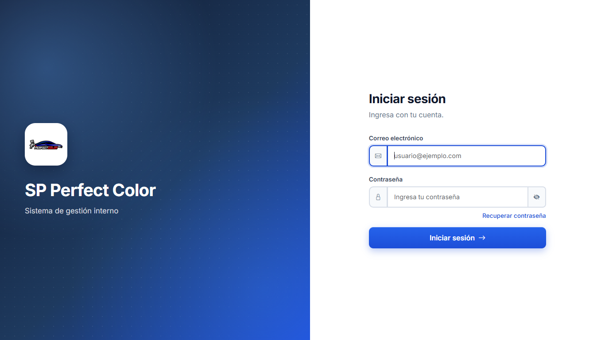
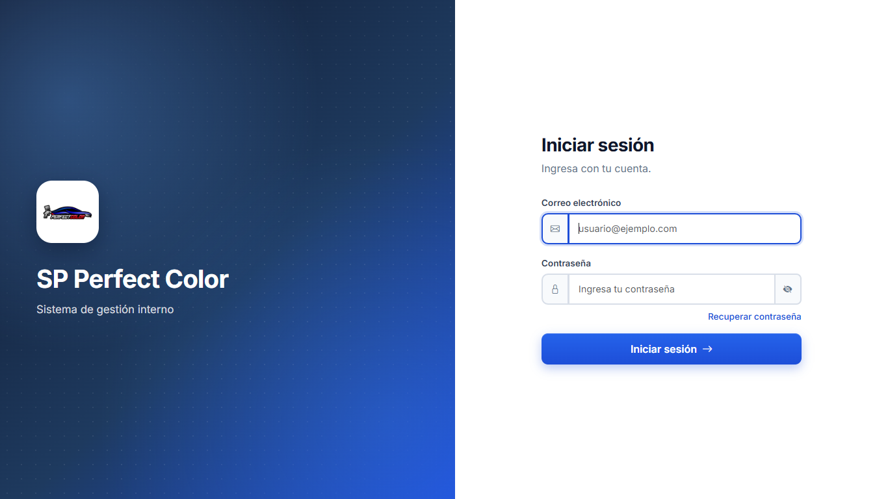
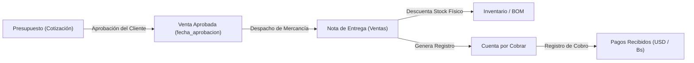

# SP Perfect Color — Sistema de Gestión Administrativa y Colorimetría

<p align="center">
  
</p>

<p align="center">
  <b>Plataforma integral de gestión administrativa, control de existencias, formulación colorimétrica de tintes automotrices y facturación comercial.</b>
</p>

<p align="center">
  
  
  
  
  
  
  
  
</p>

---

## 📋 Tabla de Contenidos
1. [Descripción General](#-descripción-general)
2. [Capturas de Pantalla](#-capturas-de-pantalla)
3. [Características Principales](#-características-principales)
4. [Arquitectura y Estándares de Software](#-arquitectura-y-estándares-de-software)
5. [Módulos del Sistema](#-módulos-del-sistema)
6. [Flujo Comercial y Modelo de Datos](#-flujo-comercial-y-modelo-de-datos)
7. [Seguridad y Hardening](#-seguridad-y-hardening)
8. [Requisitos del Sistema](#-requisitos-del-sistema)
9. [Guía de Instalación Rápida](#-guía-de-instalación-rápida)
10. [Configuración de Entorno (.env)](#-configuración-de-entorno-env)
11. [Créditos y Equipo de Desarrollo](#-créditos-y-equipo-de-desarrollo)

---

## 📖 Descripción General

**SP Perfect Color** es una solución web empresarial diseñada específicamente para negocios de pintura automotriz, talleres de latonería y centros de colorimetría técnica.

El sistema resuelve la complejidad operativa inherente a la venta de pinturas automotrices:
* **Formulación de colores a la medida:** Descuenta con precisión matemática hasta fracciones de galón ($1/128 \approx 0.0078125$ gal) de múltiples tintes base concentrados cuando se prepara un color específico.
* **Comercialización directa de insumos:** Control de herramientas, lijas, tirros, fondos y diluyentes.
* **Ciclo comercial ordenado:** Presupuestos con estados evolutivos (Cotización $\to$ Aprobado $\to$ Despacho), cuentas por cobrar/pagar y conciliación multimoneda (USD y Bolívares con tasa diaria oficial).

---

## 📸 Capturas de Pantalla

### 1. Panel de Control (Dashboard Ejecutivo)
> Métricas clave de rendimiento en tiempo real, alertas de actualización de tasa de cambio oficial, balance de ingresos/egresos y gráficos de ingresos generados dinámicamente con Chart.js.

<p align="center">
  
</p>

### 2. Formulación de Mezclas y Colorimetría Automotriz
> Asistente interactivo de formulación de pinturas. Permite mezclar tintes base concentrados, calcular automáticamente el Bill of Materials (BOM) y verificar la disponibilidad física antes del despacho.

<p align="center">
  
</p>

### 3. Catálogo de Inventario y Control de Existencias
> Visualización tabular con DataTables responsive, identificación por badges (Bases, Simples, Preparados), gestión de fracciones de galón y control de stock mínimo.

<p align="center">
  
</p>

### 4. Presupuestos y Ciclo de Ventas
> Gestión de cotizaciones comerciales, historial de aprobación con doble marca de tiempo (`fecha` y `fecha_aprobacion`), emisión de notas de entrega y enlaces a cobros.

<p align="center">
  
</p>

### 5. Auditoría y Reportes Financieros
> Generación de balances consolidados, filtros por rango de fecha y exportación instantánea a documentos ejecutivos en PDF (Dompdf) y hojas de cálculo XLSX (OpenSpout).

<p align="center">
  
</p>

### 6. Autenticación y Recuperación Segura
> Pantalla de acceso optimizada, protección contra ataques de fuerza bruta y recuperación de acceso mediante enlaces temporales firmados con HMAC.

<p align="center">
  
</p>

---

## ✨ Características Principales

* 🎯 **Precisión Colorimétrica (BOM):** Soporte en base de datos `DECIMAL(14,7)` para fracciones de galón ($1, 1/2, 1/4, 1/8, 1/16, 1/32, 1/64, 1/128$).
* 🔄 **Cadena Financiera Lineal (Cero Ciclos):** Flujo de datos estricto sin dependencias circulares:
  $$\text{ventas} \longrightarrow \text{cuentas\_cobrar} \longrightarrow \text{pagos\_recibidos}$$
* 💵 **Gestión Bimoneda (USD / Bs.):** Registro diario histórico de la tasa oficial en `tasa_cambio` con alerta proactiva en el dashboard si aún no ha sido registrada en el día.
* 🛡️ **Soft-Delete con Reactivación Inteligente:** Borrado lógico (`estado = 0`) en todas las entidades con reactivación automática si se ingresa nuevamente un identificador único existente.
* 📱 **Diseño 100% Responsivo:** Vistas fluidas en escritorio, tablets y dispositivos móviles con un sidebar retraíble persistente y formularios adaptativos.
* 📄 **Comprobantes y Reportes Profesionales:** Notas de entrega listas para impresión en papel continuo o estándar y reportes contables en PDF y Excel.

---

## 🏗️ Arquitectura y Estándares de Software

El sistema sigue una arquitectura **MVC Desacoplada (Lightweight)** en PHP nativo moderno, sin la sobrecarga de frameworks pesados:

```
Petición HTTP del Cliente
           │
           ▼
    [public/index.php]
           │
           ▼
   [frontController] ────────► Enrutamiento Seguro (White-list)
           │
  ┌────────┴────────┬───────────────────┐
  ▼                 ▼                   ▼
[SessionTrait]   [Controladores]   [Validación / CSRF]
(RBAC Permisos)     │                   │
                    ▼                   ▼
             [Modelos Base] ─────► [Core\ConexionBD (PDO Singleton)]
                    │                   │
                    ▼                   ▼
          [Vistas PHP / HTML5]   [Base de Datos Relacional]
          (Bootstrap 5 + JS)     (27 Tablas Normalizadas)
```

### Principios Aplicados:
* **Programación Orientada a Objetos Horizontal (Traits):**
  * `SessionTrait`: Manejo seguro de variables de sesión, control de inactividad y RBAC.
  * `ValidacionTrait`: Centralización de reglas de negocio para cédulas, RIFs, teléfonos venezolanos y montos.
  * `ContactoTrait`: Gestión normalizada de entidades débiles de telefonía y correos.
* **Encapsulamiento de Acceso a Datos:** Todos los modelos extienden de `ModeloBase` y ejecutan consultas a través de métodos protegidos `_ejecutarSelect`, `_ejecutarInsert` y `_ejecutarTransaccion`.
* **Cumplimiento PSR:**
  * **PSR-4:** Autocarga uniforme de namespaces (`App\` $\to$ `app/`).
  * **PSR-12:** Estándar de codificación limpia con declaraciones agrupadas (`group use`).

---

## 📦 Módulos del Sistema

| Módulo | Ruta | Icono | Descripción Operativa |
|---|:---:|:---:|---|
| **Dashboard** | `/dashboard` | `bi-speedometer2` | Resumen de ventas, alertas de tasa del día y gráfico de ingresos. |
| **Presupuestos** | `/presupuesto` | `bi-file-earmark-text` | Cotizaciones a clientes, aprobación y despacho comercial. |
| **Notas de Entrega (Ventas)** | `/notaEntrega` | `bi-receipt` | Comprobantes de despacho que descuentan inventario físico. |
| **Cuentas por Cobrar** | `/cuentaCobrar` | `bi-cash-coin` | Seguimiento de cartera a crédito y cobros en USD/Bs. |
| **Inventario** | `/inventario` | `bi-box-seam` | Catálogo de productos simples, tintes base y mezclas preparadas. |
| **Proveedores** | `/proveedor` | `bi-truck` | Directorio de casas matrices, marcas y distribuidores con RIF. |
| **Notas de Entrega (Compras)** | `/notaEntregaCompra` | `bi-box-arrow-in-down` | Recepción de mercancía que incrementa stock y genera CxP. |
| **Cuentas por Pagar** | `/cuentaPagar` | `bi-wallet2` | Compromisos con proveedores y pagos amortizados. |
| **Tasa de Cambio** | `/tasaCambio` | `bi-currency-exchange` | Registro diario de tasa de conversión oficial (USD / Bs.). |
| **Bancos y Pagos** | `/banco`, `/tipoPago` | `bi-bank` | Configuración de cuentas bancarias e instrumentos de pago. |
| **Usuarios y Roles** | `/usuario` | `bi-people` | Control de acceso granular por módulo y gestión de personal. |
| **Reportes** | `/reporte` | `bi-graph-up` | Auditoría contable descargable en PDF y Excel XLSX. |
| **Mi Perfil** | `/perfil` | `bi-person-circle` | Edición de credenciales personales y cambio de contraseña. |

---

## 📊 Flujo Comercial y Modelo de Datos

### Cadena Unificada de Ventas:


### Esquema Oficial de Base de Datos (27 Tablas Normalizadas):
El esquema completo se encuentra documentado y sincronizado en [`app/core/sp_perfect_color.sql`](app/core/sp_perfect_color.sql). Se suministra además un dataset de prueba con datos venezolanos realistas en [`app/core/datos_ejemplo.sql`](app/core/datos_ejemplo.sql).

---

## 🔒 Seguridad y Hardening

* **Cifrado de Contraseñas:** Algoritmo Bcrypt (`PASSWORD_BCRYPT`) mediante `password_hash()`.
* **Protección contra CSRF:** Tokens criptográficos obligatorios en todas las peticiones `POST` e integrados transparentemente en formularios y llamadas AJAX vía jQuery/fetch.
* **Mitigación de Inyección SQL:** Todas las consultas se ejecutan con sentencias preparadas de PDO (`ATTR_EMULATE_PREPARES => false`).
* **Protección contra Ataques de Fuerza Bruta:** Bloqueo automático por IP y correo tras intentos fallidos consecutivos de autenticación.
* **Manejo Seguro de Sesiones:** Flags `HttpOnly`, `SameSite=Lax` y regeneración periódica de ID de sesión (`session_regenerate_id`).
* **Recuperación de Contraseña:** Enlaces temporales con vencimiento de 1 hora firmados con HMAC SHA-256.

---

## 💻 Requisitos del Sistema

* **Servidor Web:** Apache 2.4 o superior con `mod_rewrite` activo.
* **PHP:** Versión 8.2 o superior (compatible con PHP 8.3 y 8.4).
* **Extensiones PHP Requeridas:**
  * `pdo_mysql`
  * `mbstring`
  * `openssl`
  * `gd`
  * `zip`
  * `curl`
* **Gestor de Base de Datos:** MySQL 8.0+ o MariaDB 10.4+.
* **Gestor de Paquetes:** Composer 2.x.

---

## 🚀 Guía de Instalación Rápida

### 1. Clonar el Repositorio
Ubica la raíz del servidor web (por ejemplo, en XAMPP `C:\xampp\htdocs\`):
```bash
cd C:\xampp\htdocs
git clone https://github.com/FranyelPacheco/SP-Perfect-Color.git "SP Perfect Color"
cd "SP Perfect Color"
```

### 2. Instalar Dependencias PHP
```bash
composer install
composer dump-autoload
```

### 3. Configurar la Base de Datos
1. Accede a phpMyAdmin o a la consola de MySQL:
   ```sql
   CREATE DATABASE sp_perfect_color CHARACTER SET utf8mb4 COLLATE utf8mb4_spanish2_ci;
   ```
2. Importa el esquema oficial con datos de prueba:
   ```bash
   mysql -u root -p sp_perfect_color < "app/core/sp_perfect_color.sql"
   ```

### 4. Configurar Variables de Entorno
Copia la plantilla de entorno:
```bash
cp .env.example .env
```
Edita `.env` con tus credenciales locales de base de datos y servidor SMTP.

### 5. Iniciar y Probar
Accede en tu navegador a:
```
http://localhost/SP%20Perfect%20Color/login
```

**Credenciales iniciales de prueba:**
* **Correo:** `admin@perfectcolor.com`
* **Contraseña:** `admin123`

---

## ⚙️ Configuración de Entorno (.env)

```ini
# Configuración de Entorno
APP_ENV=desarrollo
APP_DEBUG=true
APP_URL=http://localhost/SP%20Perfect%20Color

# Base de Datos
DB_HOST=localhost
DB_NAME=sp_perfect_color
DB_USER=root
DB_PASS=
DB_PORT=3306

# Correo Corporativo (SMTP / PHPMailer)
SMTP_HOST=smtp.gmail.com
SMTP_PORT=587
SMTP_USER=tu_correo@gmail.com
SMTP_PASS=tu_password_de_aplicacion
SMTP_SECURE=tls
SMTP_FROM_EMAIL=tu_correo@gmail.com
SMTP_FROM_NAME="SP Perfect Color"
```

---

## 👥 Créditos y Equipo de Desarrollo

* **Franyel Pacheco** — *Líder de Proyecto & Desarrollo Full Stack*
* **Jermaine Gonzalez** — *Desarrollo Backend & Base de Datos*
* **Luis Delgado** — *Desarrollo Frontend & QA*

### Asesoría Académica e Institucional:
* **Tutora Académica:** Ing. Alexis Dorante
* **Tutora Externa:** Lic. Nellyser Sánchez

---

<p align="center">
  <b>Proyecto Socio-Tecnológico — Programa Nacional de Formación en Informática (PNFI)</b><br>
  Universidad Politécnica Territorial de Lara Andrés Eloy Blanco (UPTAEB)<br>
  Barquisimeto, Estado Lara, Venezuela — 2026.
</p>
